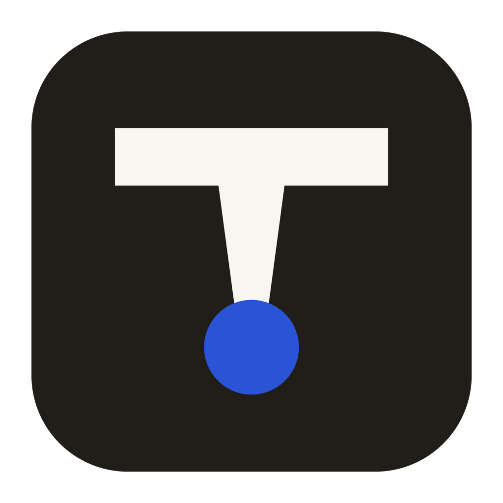
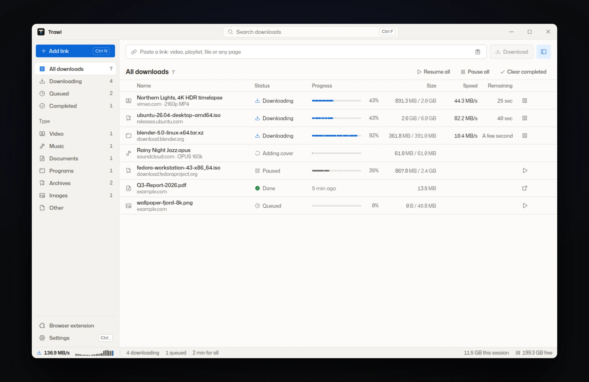
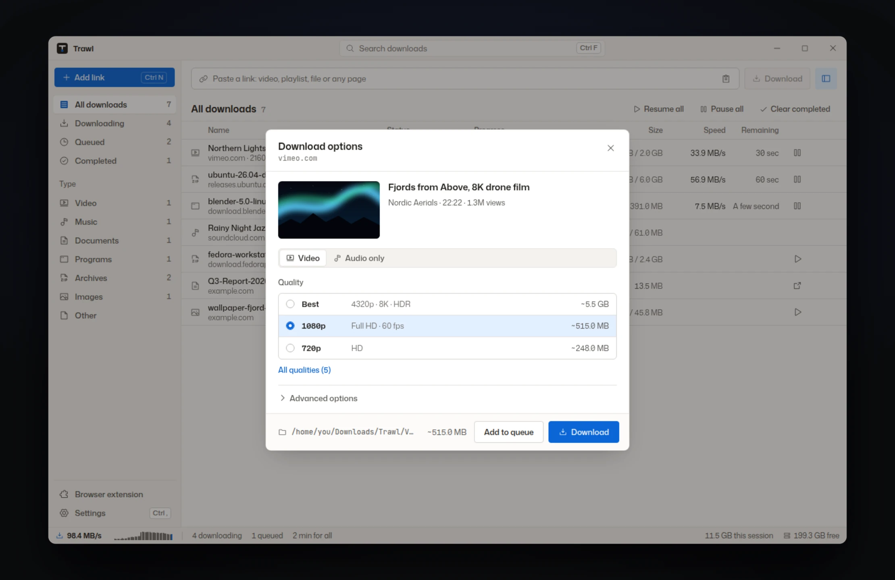

<p align="center">
  
</p>

<h1 align="center">Trawl</h1>

<p align="center">
  A download manager for Windows and Linux.<br>
  Many connections per file, video from a thousand sites, and a browser extension that catches what plays on the page.
</p>

<p align="center">
  <a href="https://github.com/saiv0n/trawl/releases/latest"></a>
  
  <a href="https://github.com/saiv0n/trawl/actions/workflows/ci.yml"></a>
</p>

<p align="center">
  <a href="https://github.com/saiv0n/trawl/releases/latest">Download</a>
  &nbsp;·&nbsp;
  <a href="#features">Features</a>
  &nbsp;·&nbsp;
  <a href="#browser-extension">Extension</a>
  &nbsp;·&nbsp;
  <a href="#building-from-source">Build</a>
</p>

<br>

<p align="center">
  <a href="https://github.com/saiv0n/trawl/releases/download/v1.0.0/trawl-demo.mp4">
    
  </a>
  <br>
  <sub>Full quality video: <a href="https://github.com/saiv0n/trawl/releases/download/v1.0.0/trawl-demo.mp4">trawl-demo.mp4</a></sub>
</p>

<br>

## Install

| Platform | File |
|---|---|
| Windows 10 and 11 | `Trawl_x.y.z_x64-setup.exe` |
| Ubuntu, Debian, Mint | `Trawl_x.y.z_amd64.deb` |
| Fedora, openSUSE | `Trawl-x.y.z-1.x86_64.rpm` |
| Any other distro | `Trawl_x.y.z_amd64.AppImage` |

All of them are on the [releases page](https://github.com/saiv0n/trawl/releases/latest). The installer has no code signing certificate yet, so Windows SmartScreen asks once before it runs.

On first start Trawl sets up yt-dlp, ffmpeg and deno by itself. If they are already on your PATH it uses those.

## Features

<picture>
  <source media="(prefers-color-scheme: dark)" srcset="assets/shot-dark.webp">
  
</picture>

### Downloads

- 1 to 32 connections per file. A connection that finishes early splits the largest piece left and takes half of it
- Piece state is written to disk every 3 seconds, so downloads continue after a crash, a reboot or a dropped network
- Queue with a limit on parallel downloads, a global speed limit and a separate limit for set hours
- Per-download speed limit and a connection cap per server
- Scheduler with day selection, HTTP and SOCKS5 proxy
- Batch add with patterns like `photo[001-120].jpg`, list export and import
- Folder rules by extension or site, and per-site username and password

### Video and audio

<picture>
  <source media="(prefers-color-scheme: dark)" srcset="assets/shot-add-dark.webp">
  
</picture>

- YouTube, Vimeo, TikTok, Instagram, X, Twitch and every other site yt-dlp supports
- Quality up to 8K and HDR, MP4, MKV or WebM, or audio only as MP3, M4A, OPUS, FLAC or WAV
- Embedded subtitles and chapters, SponsorBlock, whole playlists
- Uses your browser's cookies for age-restricted and members-only videos
- yt-dlp updates itself daily. If a new version won't start, the old one comes back

### After a download

- MD5, SHA-1 or SHA-256 check. If the server has a `file.sha256` next to the file, it's compared automatically
- Optional virus scan, archive extraction, opening the file or running your own command
- The file is tagged with its source URL, the same way browsers do it
- Sleep, hibernate, shut down or quit when everything is done

### Around the app

- Page grabber that finds video, audio, images, documents and stream URLs hidden in scripts, and can follow links a level or two deep
- Clipboard watching, drag and drop, tray icon, notifications, start on login
- Light and dark themes with three accent colors, English and Turkish

## Browser extension

The extension catches media as it plays, including HLS and DASH streams, takes over browser downloads, adds a context menu entry and puts a download button on YouTube. Shift-click grabs the video right away, Alt-click grabs the audio.

It talks to the app through native messaging and a local server on `127.0.0.1:47321` that only answers the extension. Trawl registers itself for Chrome, Chromium, Edge, Brave and Vivaldi on every start, and on Linux also for Firefox, LibreWolf, Waterfox, Floorp and Zen.

Chrome and other Chromium browsers: open `chrome://extensions`, turn on Developer mode, choose "Load unpacked" and pick the `extension` folder.

Firefox and LibreWolf: run `npm run ext:build` and install `extension-dist/trawl-firefox-*.zip`. LibreWolf keeps it after turning off `xpinstall.signatures.required` in `about:config`. Regular Firefox only takes unsigned extensions as temporary add-ons from `about:debugging`. Flatpak builds of these browsers can't reach the app from their sandbox.

## Windows and Linux

| | Windows | Linux |
|---|---|---|
| Data | `%APPDATA%\Trawl` | `~/.local/share/Trawl` |
| Cookies and passwords | encrypted with DPAPI | in a folder only your user can read |
| Virus scan | Windows Defender | ClamAV |
| Archives | built-in `tar.exe` | `tar`, `7z` or `unzip` |
| Source tag on files | `Zone.Identifier` | `user.xdg.origin.url` |
| yt-dlp | the one on PATH if there is one | its own copy, distro packages fall behind fast |

On Windows, an empty file named `portable` next to the exe keeps settings, the list and components in a `data` folder beside it.

## Building from source

You need Node 22 and stable Rust.

```bash
npm install
npx tauri dev
```

For the UI alone with sample data, run `npx vite` and open http://localhost:1420. Add `?demo&lang=en` for the data used in the screenshots.

Windows installer:

```powershell
npx tauri build --bundles nsis
```

Linux packages, after installing the WebKitGTK headers (Ubuntu and Debian names):

```bash
sudo apt install libwebkit2gtk-4.1-dev librsvg2-dev libxdo-dev libsoup-3.0-dev libayatana-appindicator3-dev patchelf
npx tauri build --bundles deb,rpm,appimage
```

Pushing a `v*` tag builds every package in CI and drafts a release with them.

## Layout

| Path | |
|---|---|
| `src-tauri/src/http.rs` | multi-connection HTTP downloads |
| `src-tauri/src/media.rs` | yt-dlp |
| `src-tauri/src/scrape.rs` | page grabber |
| `src-tauri/src/manager.rs` | queue and saved state |
| `src-tauri/src/post.rs` | checks and actions after a download |
| `src-tauri/src/tools.rs` | component installer |
| `src-tauri/src/bridge.rs` | local server for the extension |
| `src-tauri/src/native.rs` | native messaging host |
| `src/` | UI, Svelte 5 |
| `extension/` | browser extension |

## Notes

yt-dlp is Unlicense and ffmpeg is the LGPL build, run as a separate program. Downloading from some sites may go against their terms of service, so check before you do.
